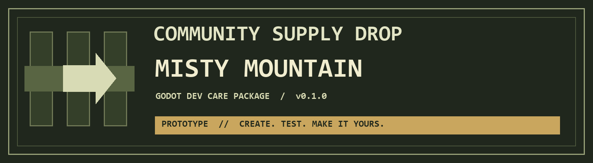

**🏠 Home** · [Characters](characters/README.md) · [Toy Box](toy-box/README.md) · [Playable Starter](starter/README.md)

---

# Hermes Community Care Package

**Pick a character, grab a prop, or try a small game.** Editable community creations from Mike.

## 🧑 Characters
Community characters and Teknium variants, with pictures and individual Blender downloads.

**[Browse characters →](characters/README.md)** · [How to open a model](characters/GETTING_STARTED.md)

## 📦 Toy Box
Props, scenery and earlier character models. Blender files, plus GLB where available.

**[Browse the Toy Box →](toy-box/README.md)** · [How to use an asset](toy-box/GETTING_STARTED.md)

## 🎮 Playable Starter
Explore Misty Mountain as Teknium or Doge Man. A small editable Godot learning prototype—not a finished game or browser demo.

**[Open the starter →](starter/README.md)** · [Download the starter](https://github.com/123mikeyd/hermes-community-care-package/releases/tag/v0.1.0-prototype)

---

**Downloading models?** Use the individual **.blend** or **GLB** links in the catalogs. GitHub's **Code → Download ZIP** does not include those release attachments.

**Finding your way back?** Every guide has Home and section links at the top and bottom. You do not need the file sidebar.

<strong>More about the playable starter: contents, controls and limitations</strong>

**v0.1.0-prototype — a small, editable place to start making games.**
Walk a mountain meadow as Teknium or Doge Man, collect a token, activate a checkpoint, then experiment in your own copy. Community-made by Mike with Hermes assistance; intentionally a testing and learning kit, not a finished game.

[Download the complete source ZIP](https://github.com/123mikeyd/hermes-community-care-package/releases/tag/v0.1.0-prototype) · [Quick start](starter/QUICKSTART.md) · [Learning notes](starter/LEARNING.md)

## Open your supply drop

1. Download and extract the **whole** release ZIP, or clone this repository.
2. Install the standard [Godot editor](https://godotengine.org/download/). The tested version is **4.7.2**, using the Compatibility renderer on Windows 11.
3. Import **`starter/project.godot`**, let asset import finish, then press **F5**.
4. Optional Windows shortcuts: `starter/PLAY.cmd` and `starter/EDIT.cmd`. Set `GODOT_EXE` if automatic engine discovery fails.

No engine is bundled. No Blender, Hermes, Meshy, account, API key or paid plugin is needed to play. Players, lighting and examples are created at runtime, so F5 is more useful than the initial editor viewport. Keep an untouched copy before experimenting.

## Inside the crate

- Mike's Misty Mountain landscape, made in a VR Sketch app, with a bounded meadow.
- Two textured native character rigs, each with original **Idle / Walk / Run** replacement motion.
- Camera-relative movement, character switching, camera orbit/zoom and safe respawn.
- Working E-interaction, once-only token pickup and checkpoint examples.
- A parked collidable car and a floating, inspectable gun display — not driving or combat systems.
- Complete Godot scripts, scenes, shaders, import settings, launchers and teaching/test source.
- [Editable procedural animation authoring source and actual motion preview](animation-source/README.md).

## Controls

| Input | Action |
|---|---|
| WASD / hold Shift | Walk / run |
| 1 / 2 | Teknium / Doge Man |
| E | Interact with the nearest example within range |
| Q / C · mouse wheel | Orbit · zoom |
| R | Respawn, retaining session progress |
| F | Reset token and checkpoint progress |
| H / Esc | Help / quit |

Try the turquoise token, then the amber checkpoint: approach and press E. The checkpoint turns green. R returns you there; F restarts the lesson. Switching character keeps progress; closing the game does not.

## Four learning challenges

These are deliberately **not implemented**:

1. **Add jump:** introduce gravity, floor contact and one dependable landing without breaking walking or respawn.
2. **Expand the terrain safely:** test slopes, collision, camera clearance and recovery beyond one boundary before moving the fence.
3. **Equip the gun:** add an attachment and equip/unequip state before considering firing; preserve the display example.
4. **Drive the car:** create enter/exit, steering and safe reset in a separate experiment copy.

[Optional Hermes conversation prompts](starter/HERMES_PROMPTS.md) help you read the existing code and make one small change at a time.

## Prototype limitations

The invisible meadow walls can make the characters look silly when pushing into them. The outer mountain is not promised traversable. Motion is deliberately simple/procedural; Run is brisk stepping rather than a polished sprint, and slopes/turning may show foot-slide. No terrain-adaptive foot IK, jumping, gunfire, driving, saves, networking or audio is included. Clouds/fog are provisional. Display markers and gun are non-solid, and interaction uses proximity rather than line of sight.

The accepted gameplay was tested previously on Windows 11; original replacement motion received bounded import/pose checks. This publication only changes documentation and presentation labels and verifies packaging/upload integrity. It does not claim a new gameplay regression. Other platforms, browser/mobile exports and gamepads are unverified. See [verification scope](docs/TEST_SCOPE.md).

## Sharing and credits

Community-made and unofficial. These mixed community/fan-art assets have no blanket commercial-use license. **[Read the sharing notice](NOTICE.md)** before redistributing.

---

**🏠 Home** · [Characters](characters/README.md) · [Toy Box](toy-box/README.md) · [Playable Starter](starter/README.md)
