[🏠 Home](../README.md) · **Characters** · [Toy Box](../toy-box/README.md) · [Playable Starter](../starter/README.md)

---

# Community characters — model-only Blender catalog

**[Jump to models and downloads ↓](#individual-files)**

**44 individual .blend downloads; 25 base character identities.** Teknium appears once in that base roster and has additional skins/rig alternatives: **10 discovered full-body skin families represented by 17 full-body files**, plus **3 separate modular components**. These are not 44 different characters or 20 different Teknium skins.

[Download release](https://github.com/123mikeyd/hermes-community-care-package/releases/tag/characters-v0.1.1) · [Getting started](GETTING_STARTED.md) · [Machine-readable catalog](catalog.json) · [Checksums](SHA256SUMS) · [Scoped notice](NOTICE.md)

All files are **model-only**, saved in native rest display with packed textures. Zero Actions/NLA, no dances or inherited motion libraries. Native mesh density, UVs, materials, weights and rest bones are preserved. Rigged does not mean polished: rough weights remain. Static/unbound models are explicitly labeled. Optional GLBs were not qualified for this release, so only Blender files are provided.

**Excluded entirely:** Mephisto's Girl, Faded Demon and Heartbreaker. No full parade preview or combined parade scene is included. The existing Godot starter and earlier Toy Box releases are unchanged.

## Arts Bro — masked rig addition

The new masked Arts Bro is included with his existing bound 66-bone rig and three packed 4K maps. The remaining 43 earlier downloads remain in [v0.1.0](https://github.com/123mikeyd/hermes-community-care-package/releases/tag/characters-v0.1.0); v0.1.1 adds only Arts Bro and refreshed catalog documents. The MMO Body and MMO Warrior character downloads have been withdrawn; other model files are unchanged.

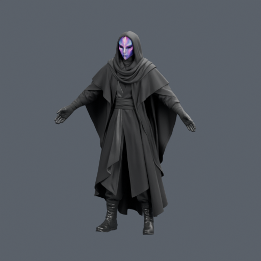 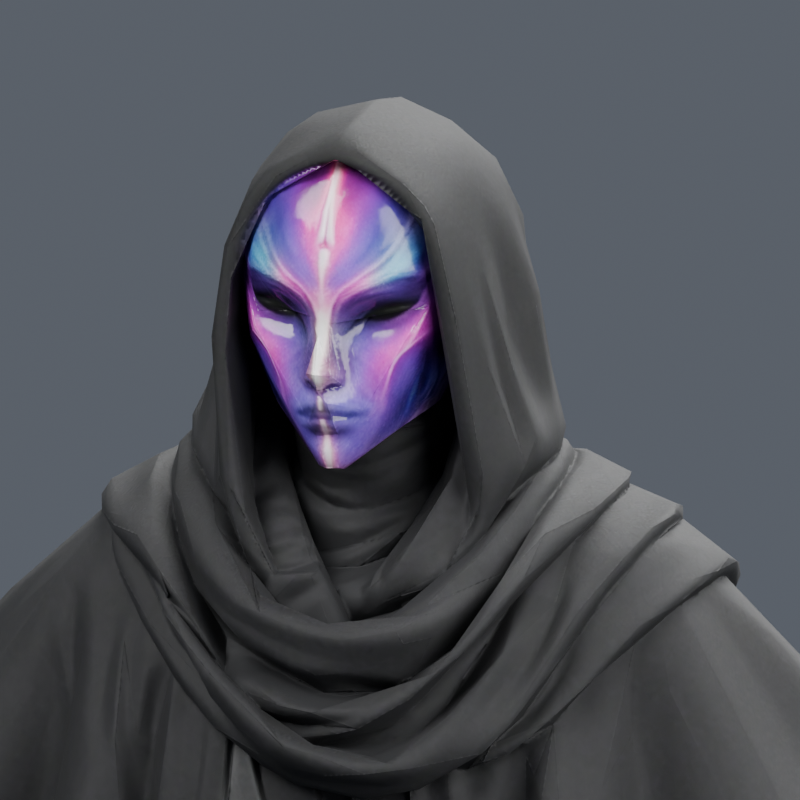

## Browse

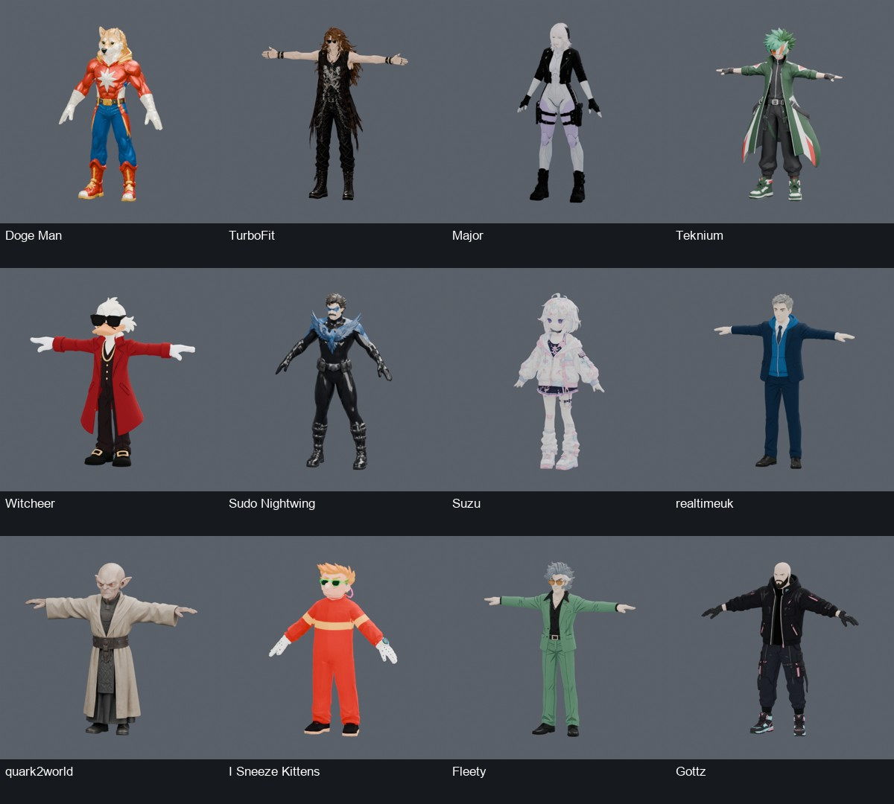

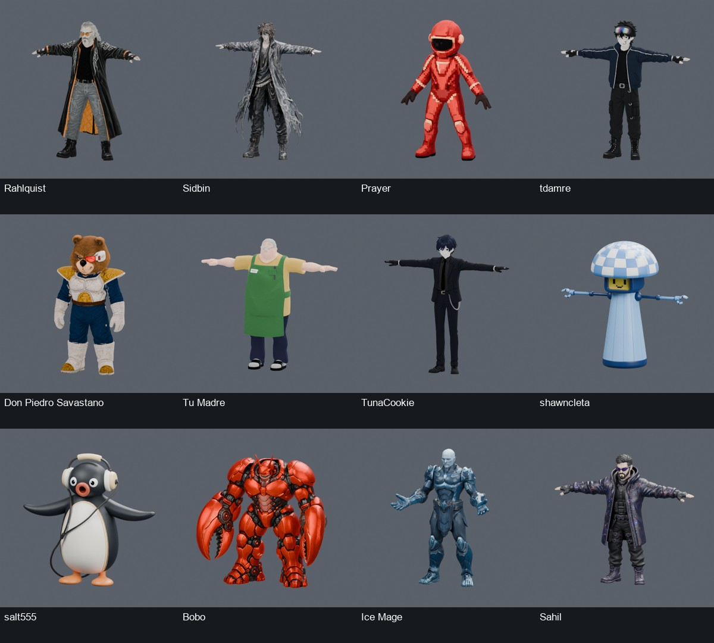

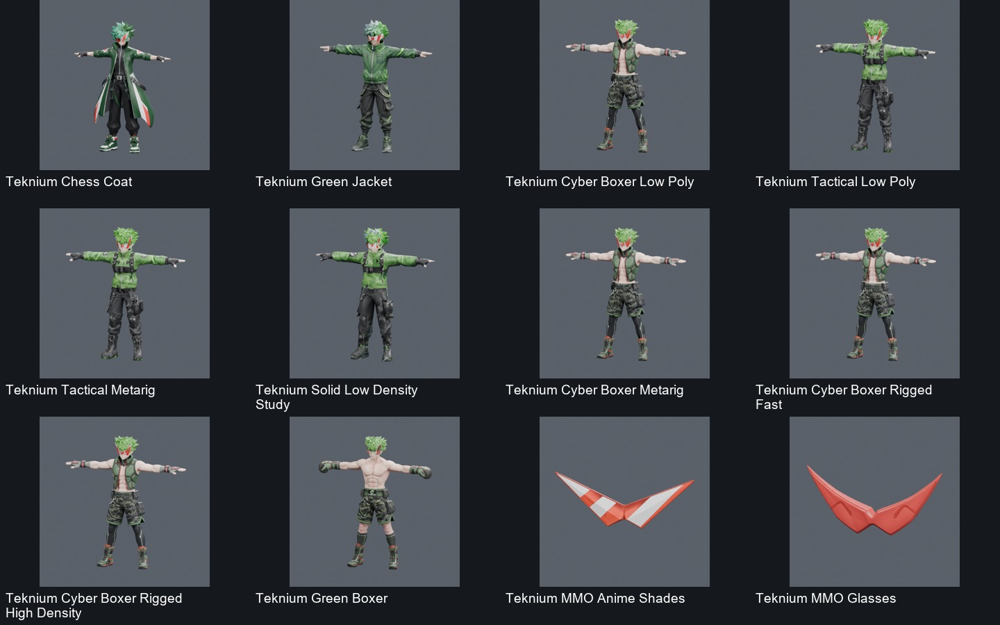

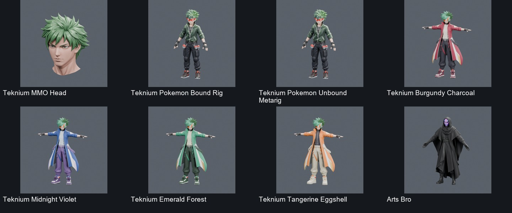

## Individual files

| Preview | Character / variant | Native density | Rig / deformation | Download |
|---|---|---|---|---|
| 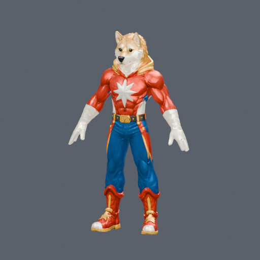 | **Doge Man** Native model  | 13,885 vertices 9,288 triangles | 24 bones. Bound native rig; sampled deformation responds; rough weights, not production animation acceptance. | [.blend](https://github.com/123mikeyd/hermes-community-care-package/releases/download/characters-v0.1.0/doge-man.blend) 28.6 MiB |
| 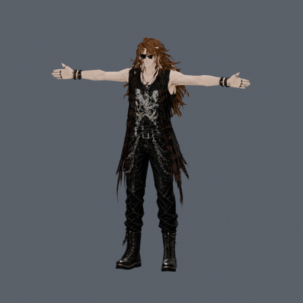 | **TurboFit** Native model  | 19,971 vertices 10,570 triangles | 33 bones. Bound native rig; sampled deformation responds; rough weights, not production animation acceptance. | [.blend](https://github.com/123mikeyd/hermes-community-care-package/releases/download/characters-v0.1.0/turbofit.blend) 41.7 MiB |
| 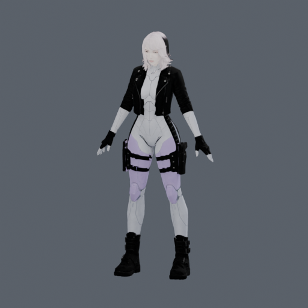 | **Major** Native model  | 16,104 vertices 10,377 triangles | 24 bones. Bound native rig; sampled deformation responds; rough weights, not production animation acceptance. | [.blend](https://github.com/123mikeyd/hermes-community-care-package/releases/download/characters-v0.1.0/major.blend) 21.1 MiB |
| 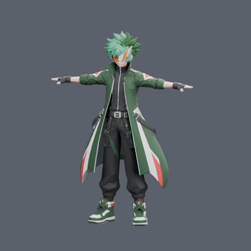 | **Teknium** Classic Chess Coat Same Classic Chess Coat design as the unrigged mesh alternative; one skin family. | 14,945 vertices 10,323 triangles | 24 bones. Bound native rig; sampled deformation responds; rough weights, not production animation acceptance. | [.blend](https://github.com/123mikeyd/hermes-community-care-package/releases/download/characters-v0.1.0/teknium.blend) 19.6 MiB |
| 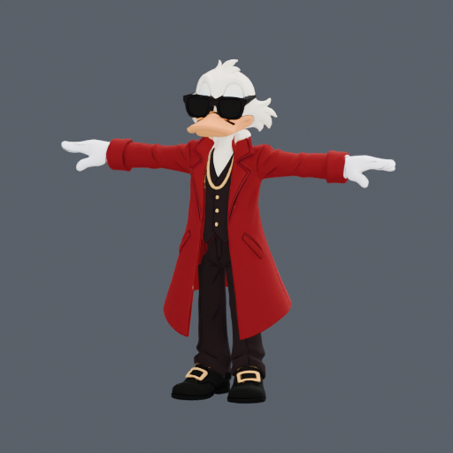 | **Witcheer** Native model  | 69,650 vertices 82,866 triangles | 24 bones. Bound native rig; sampled deformation responds; rough weights, not production animation acceptance. | [.blend](https://github.com/123mikeyd/hermes-community-care-package/releases/download/characters-v0.1.0/witcheer.blend) 30.9 MiB |
| 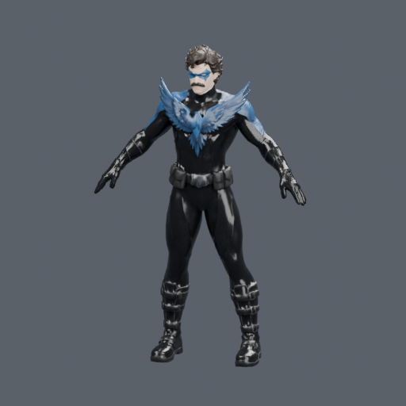 | **Sudo Nightwing** Native model  | 16,001 vertices 32,202 triangles | 22 bones. Bound native rig; sampled deformation responds; rough weights, not production animation acceptance. | [.blend](https://github.com/123mikeyd/hermes-community-care-package/releases/download/characters-v0.1.0/sudo-nightwing.blend) 24.5 MiB |
| 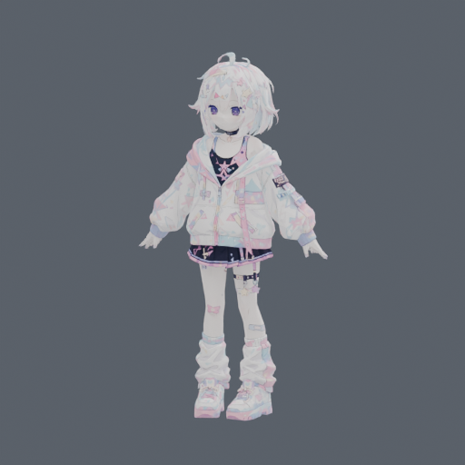 | **Suzu** Native model  | 17,907 vertices 10,350 triangles | 24 bones. Bound native rig; sampled deformation responds; rough weights, not production animation acceptance. | [.blend](https://github.com/123mikeyd/hermes-community-care-package/releases/download/characters-v0.1.0/suzu.blend) 20.5 MiB |
| 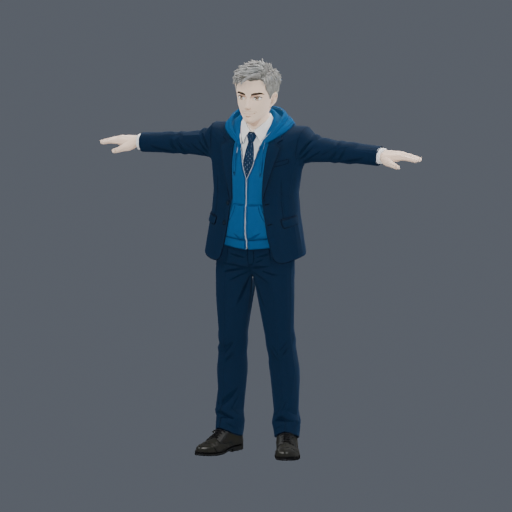 | **realtimeuk** Native model  | 16,125 vertices 10,364 triangles | 24 bones. Bound native rig; sampled deformation responds; rough weights, not production animation acceptance. | [.blend](https://github.com/123mikeyd/hermes-community-care-package/releases/download/characters-v0.1.0/realtimeuk.blend) 22.4 MiB |
| 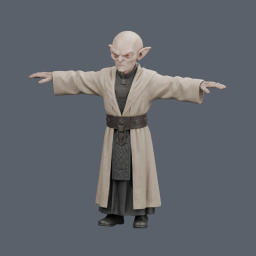 | **quark2world** Native model  | 29,903 vertices 25,520 triangles | 66 bones. Bound native rig; sampled deformation responds; rough weights, not production animation acceptance. | [.blend](https://github.com/123mikeyd/hermes-community-care-package/releases/download/characters-v0.1.0/quark2world.blend) 30.6 MiB |
| 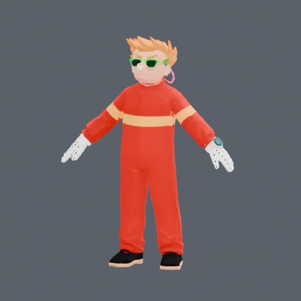 | **I Sneeze Kittens** Native model  | 5,505 vertices 3,384 triangles | 24 bones. Bound native rig; sampled deformation responds; rough weights, not production animation acceptance. | [.blend](https://github.com/123mikeyd/hermes-community-care-package/releases/download/characters-v0.1.0/i-sneeze-kittens.blend) 22.1 MiB |
| 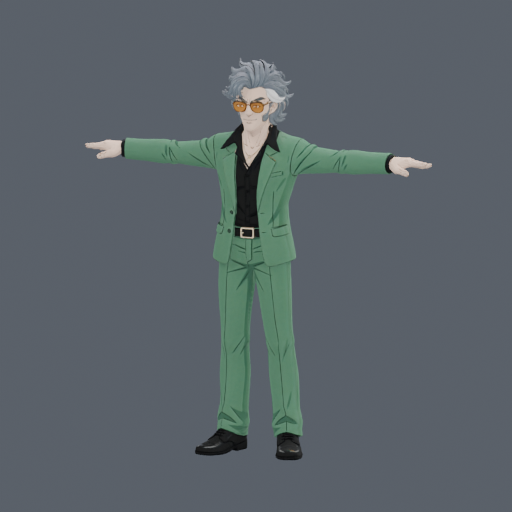 | **Fleety** Native model  | 34,127 vertices 30,948 triangles | 24 bones. Bound native rig; sampled deformation responds; rough weights, not production animation acceptance. | [.blend](https://github.com/123mikeyd/hermes-community-care-package/releases/download/characters-v0.1.0/fleety.blend) 27.0 MiB |
| 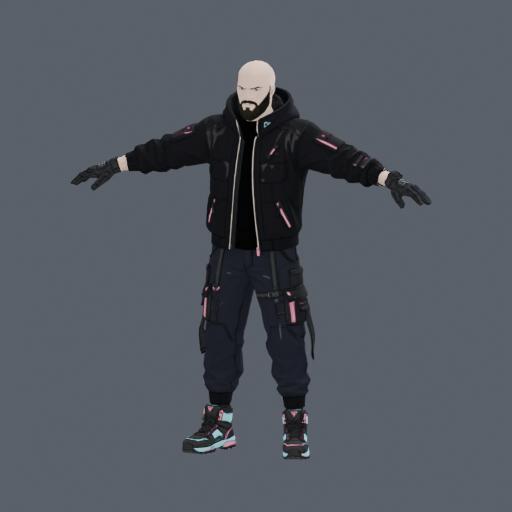 | **Gottz** Native model  | 16,553 vertices 10,381 triangles | 24 bones. Bound native rig; sampled deformation responds; rough weights, not production animation acceptance. | [.blend](https://github.com/123mikeyd/hermes-community-care-package/releases/download/characters-v0.1.0/gottz.blend) 22.4 MiB |
| 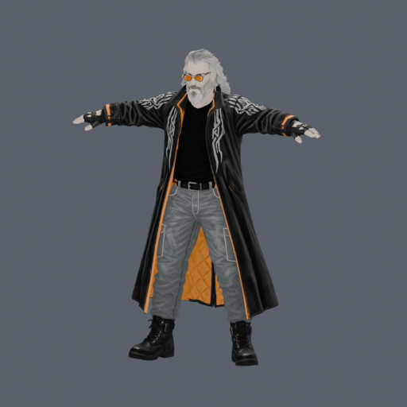 | **Rahlquist** Native model  | 18,456 vertices 10,277 triangles | 24 bones. Bound native rig; sampled deformation responds; rough weights, not production animation acceptance. | [.blend](https://github.com/123mikeyd/hermes-community-care-package/releases/download/characters-v0.1.0/rahlquist.blend) 23.6 MiB |
| 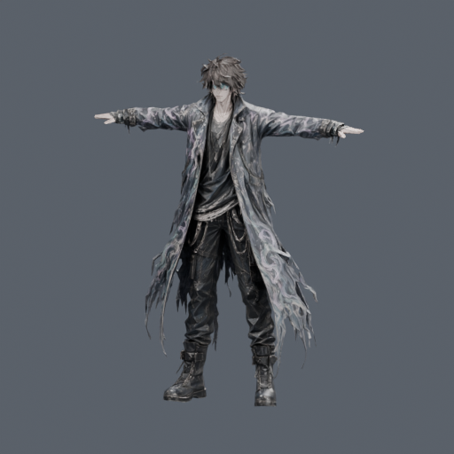 | **Sidbin** Native model  | 21,241 vertices 10,118 triangles | 66 bones. Bound native rig; sampled deformation responds; rough weights, not production animation acceptance. | [.blend](https://github.com/123mikeyd/hermes-community-care-package/releases/download/characters-v0.1.0/sidbin.blend) 34.5 MiB |
| 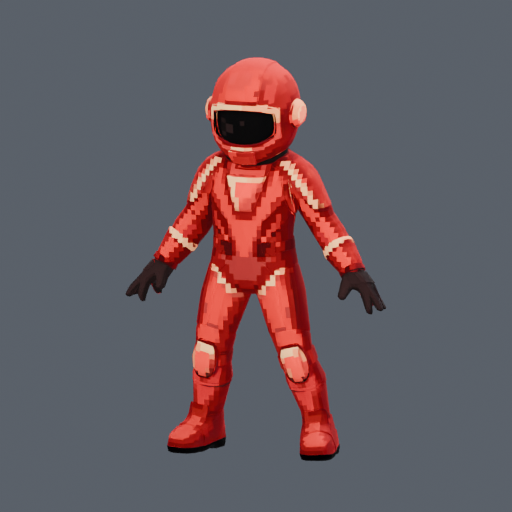 | **Prayer** Native model  | 8,971 vertices 6,444 triangles | 24 bones. Bound native rig; sampled deformation responds; rough weights, not production animation acceptance. | [.blend](https://github.com/123mikeyd/hermes-community-care-package/releases/download/characters-v0.1.0/prayer.blend) 18.2 MiB |
| 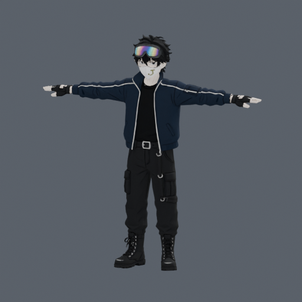 | **tdamre** Native model  | 17,201 vertices 10,358 triangles | 24 bones. Bound native rig; sampled deformation responds; rough weights, not production animation acceptance. | [.blend](https://github.com/123mikeyd/hermes-community-care-package/releases/download/characters-v0.1.0/tdamre.blend) 21.5 MiB |
| 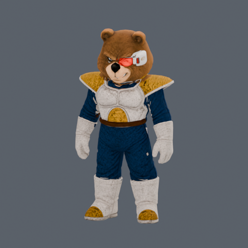 | **Don Piedro Savastano** Native model  | 10,723 vertices 8,530 triangles | 24 bones. Bound native rig; sampled deformation responds; rough weights, not production animation acceptance. | [.blend](https://github.com/123mikeyd/hermes-community-care-package/releases/download/characters-v0.1.0/don-piedro-savastano.blend) 25.7 MiB |
| 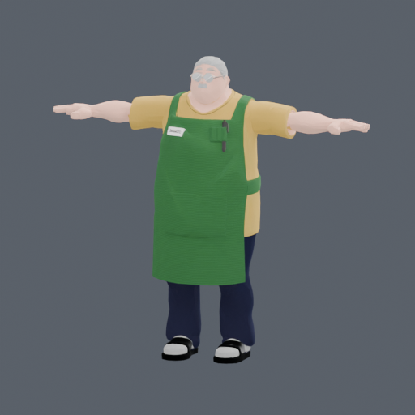 | **Tu Madre** Native model Also known as tu_madre. | 9,209 vertices 8,211 triangles | 24 bones. Bound native rig; sampled deformation responds; rough weights, not production animation acceptance. | [.blend](https://github.com/123mikeyd/hermes-community-care-package/releases/download/characters-v0.1.0/tu-madre.blend) 19.4 MiB |
| 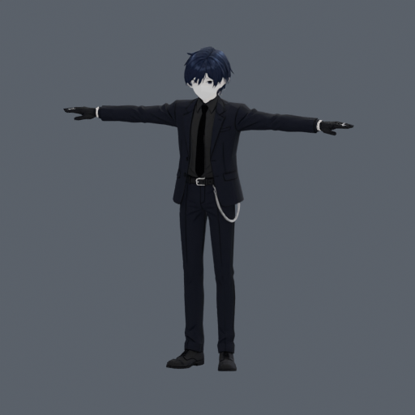 | **TunaCookie** Native model  | 17,811 vertices 10,292 triangles | 24 bones. Bound native rig; sampled deformation responds; rough weights, not production animation acceptance. | [.blend](https://github.com/123mikeyd/hermes-community-care-package/releases/download/characters-v0.1.0/tunacookie.blend) 18.7 MiB |
| 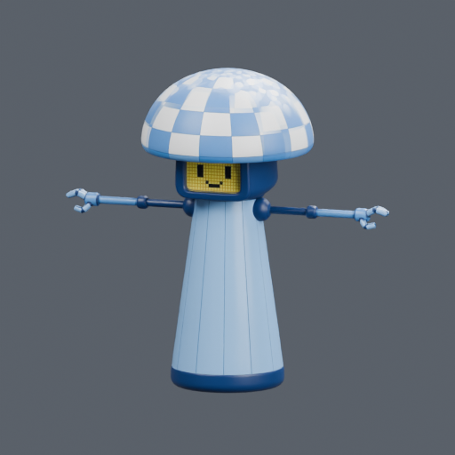 | **shawncleta** Native model Mushroom mascot. | 88,792 vertices 177,588 triangles | 4 bones. Bound native rig; sampled deformation responds; rough weights, not production animation acceptance. | [.blend](https://github.com/123mikeyd/hermes-community-care-package/releases/download/characters-v0.1.0/shawncleta.blend) 35.8 MiB |
|  | **salt555** Native model Penguin mascot. | 132,973 vertices 265,963 triangles | 6 bones. Bound native rig; sampled deformation responds; rough weights, not production animation acceptance. | [.blend](https://github.com/123mikeyd/hermes-community-care-package/releases/download/characters-v0.1.0/salt555.blend) 42.2 MiB |
| 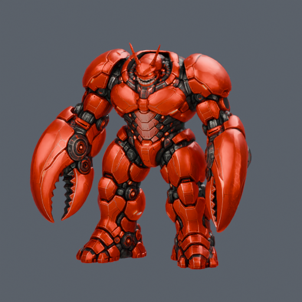 | **Bobo** Native model  | 33,414 vertices 31,104 triangles | 24 bones. Bound native rig; sampled deformation responds; rough weights, not production animation acceptance. | [.blend](https://github.com/123mikeyd/hermes-community-care-package/releases/download/characters-v0.1.0/bobo.blend) 32.7 MiB |
| 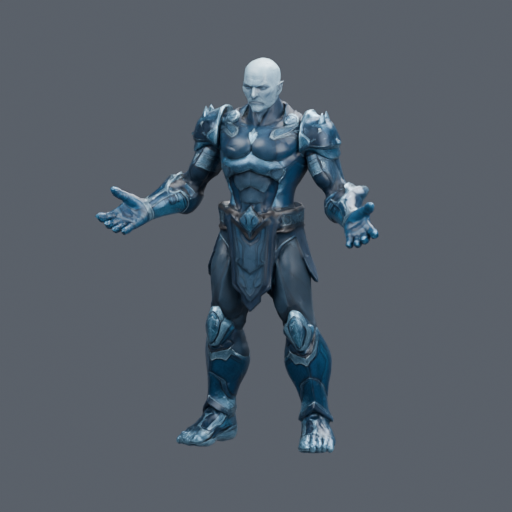 | **Ice Mage** Native model  | 31,065 vertices 34,972 triangles | 24 bones. Bound native rig; sampled deformation responds; rough weights, not production animation acceptance. | [.blend](https://github.com/123mikeyd/hermes-community-care-package/releases/download/characters-v0.1.0/ice-mage.blend) 31.5 MiB |
| 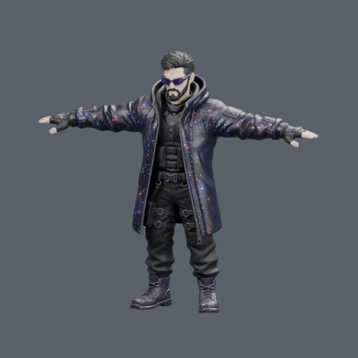 | **Sahil** Native model  | 525,900 vertices 1,051,993 triangles | 24 bones. Bound native rig; sampled deformation responds; rough weights, not production animation acceptance. | [.blend](https://github.com/123mikeyd/hermes-community-care-package/releases/download/characters-v0.1.0/sahil.blend) 139.8 MiB |
| 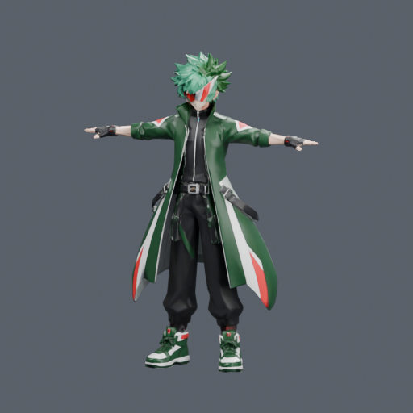 | **Teknium Chess Coat** Classic Chess Coat Unrigged native mesh alternative of the Classic Chess Coat skin; not another identity. | 5,146 vertices 10,323 triangles | 0 bones. Unrigged static mesh; no armature. | [.blend](https://github.com/123mikeyd/hermes-community-care-package/releases/download/characters-v0.1.0/teknium-chess-coat.blend) 26.9 MiB |
| 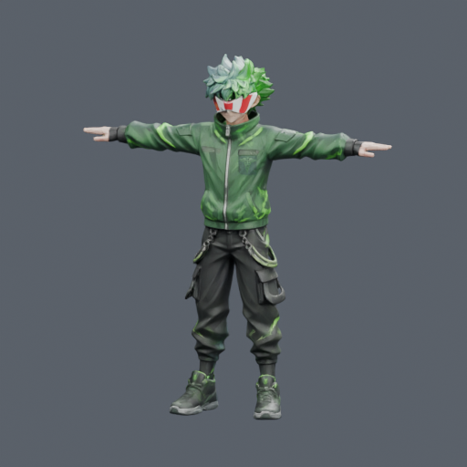 | **Teknium Green Jacket** Green Jacket  | 60,520 vertices 121,200 triangles | 0 bones. Unrigged static mesh; no armature. | [.blend](https://github.com/123mikeyd/hermes-community-care-package/releases/download/characters-v0.1.0/teknium-green-jacket.blend) 56.1 MiB |
| 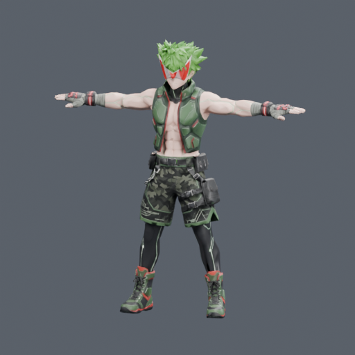 | **Teknium Cyber Boxer Low Poly** Cyber Boxer A metarig alternative of this same mesh is also listed; neither low-poly copy is bound. | 4,859 vertices 9,878 triangles | 0 bones. Unrigged static mesh; no armature. | [.blend](https://github.com/123mikeyd/hermes-community-care-package/releases/download/characters-v0.1.0/teknium-cyber-boxer-low-poly.blend) 28.8 MiB |
|  | **Teknium Tactical Low Poly** Tactical A metarig alternative of this same mesh is also listed; neither low-poly copy is bound. | 4,864 vertices 9,801 triangles | 0 bones. Unrigged static mesh; no armature. | [.blend](https://github.com/123mikeyd/hermes-community-care-package/releases/download/characters-v0.1.0/teknium-tactical-low-poly.blend) 28.1 MiB |
| 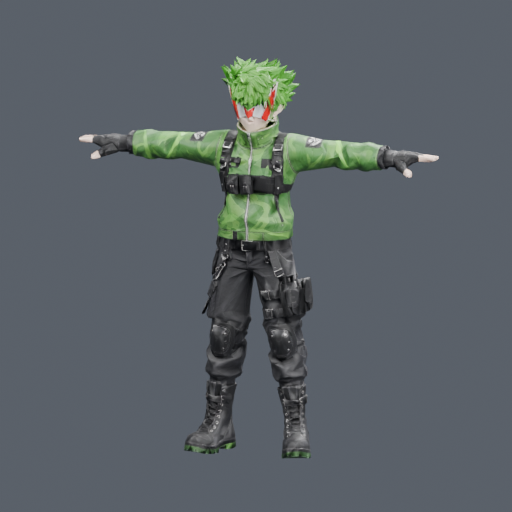 | **Teknium Tactical Metarig** Tactical Geometry and packed textures match the corresponding low-poly alternative; metarig remains unbound. | 4,864 vertices 9,801 triangles | 68 bones. Existing unbound metarig; NOT a working deformation rig. | [.blend](https://github.com/123mikeyd/hermes-community-care-package/releases/download/characters-v0.1.0/teknium-tactical-metarig.blend) 28.3 MiB |
| 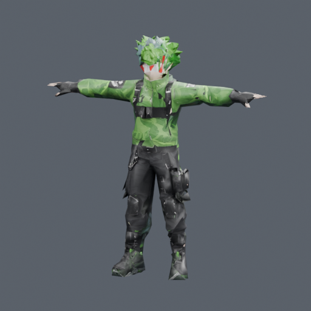 | **Teknium Solid Low Density Study** Tactical Earlier low-density tactical study; native two-part mesh and unbound metarig retained, not counted as a new skin. | 1,358 vertices 2,842 triangles | 68 bones. Existing unbound metarig; NOT a working deformation rig. | [.blend](https://github.com/123mikeyd/hermes-community-care-package/releases/download/characters-v0.1.0/teknium-solid-low-density-study.blend) 65.2 MiB |
|  | **Teknium Cyber Boxer Metarig** Cyber Boxer Geometry and packed textures match the corresponding low-poly alternative; metarig remains unbound. | 4,859 vertices 9,878 triangles | 44 bones. Existing unbound metarig; NOT a working deformation rig. | [.blend](https://github.com/123mikeyd/hermes-community-care-package/releases/download/characters-v0.1.0/teknium-cyber-boxer-metarig.blend) 28.9 MiB |
| 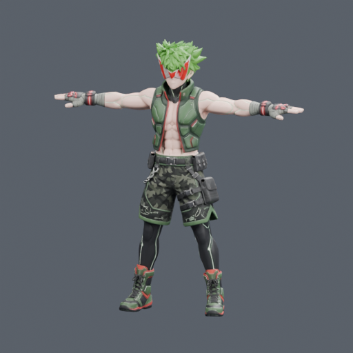 | **Teknium Cyber Boxer Rigged Fast** Cyber Boxer Existing Rigify controls retained; embedded UI script omitted. Dense and fast alternatives are one skin, not extra characters. | 51,266 vertices 102,803 triangles | 706 bones. Bound native rig; sampled deformation responds; rough weights, not production animation acceptance. | [.blend](https://github.com/123mikeyd/hermes-community-care-package/releases/download/characters-v0.1.0/teknium-cyber-boxer-rigged-fast.blend) 37.8 MiB |
| 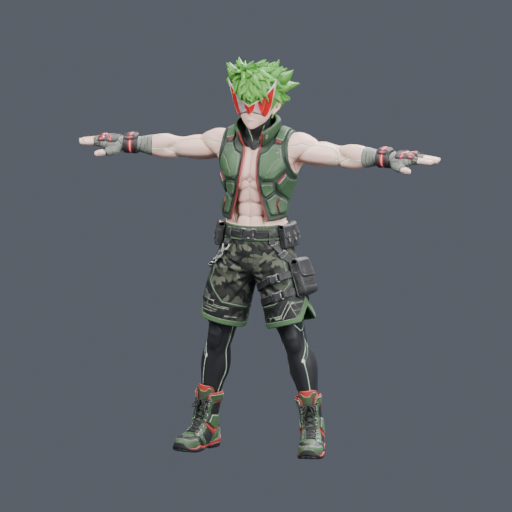 | **Teknium Cyber Boxer Rigged High Density** Cyber Boxer Existing Rigify controls retained; embedded UI script omitted. Dense and fast alternatives are one skin, not extra characters. | 513,887 vertices 1,028,045 triangles | 706 bones. Bound native rig; sampled deformation responds; rough weights, not production animation acceptance. | [.blend](https://github.com/123mikeyd/hermes-community-care-package/releases/download/characters-v0.1.0/teknium-cyber-boxer-rigged-high-density.blend) 142.6 MiB |
| 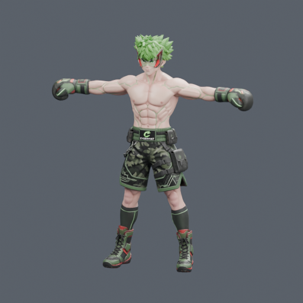 | **Teknium Green Boxer** Green Boxer  | 450,569 vertices 901,321 triangles | 0 bones. Unrigged static mesh; no armature. | [.blend](https://github.com/123mikeyd/hermes-community-care-package/releases/download/characters-v0.1.0/teknium-green-boxer.blend) 102.3 MiB |
| 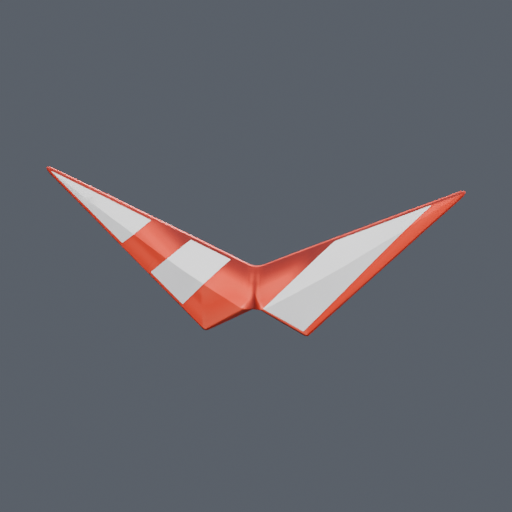 | **Teknium MMO Anime Shades** Modular MMO component Standalone modular component, not a full character. Head and glasses stay separate; no automatic assembly. | 27,146 vertices 54,288 triangles | 0 bones. Unrigged static mesh; no armature. | [.blend](https://github.com/123mikeyd/hermes-community-care-package/releases/download/characters-v0.1.0/teknium-mmo-anime-shades.blend) 23.7 MiB |
| 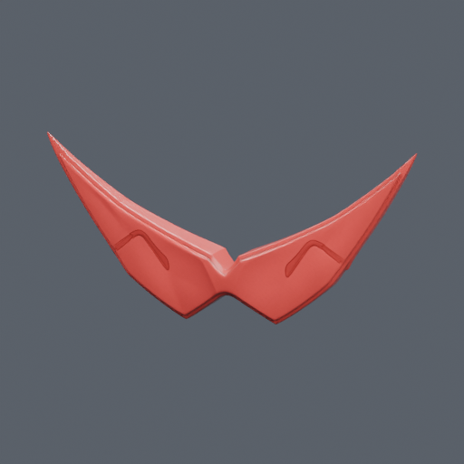 | **Teknium MMO Glasses** Modular MMO component Standalone modular component, not a full character. Head and glasses stay separate; no automatic assembly. | 94,114 vertices 188,224 triangles | 0 bones. Unrigged static mesh; no armature. | [.blend](https://github.com/123mikeyd/hermes-community-care-package/releases/download/characters-v0.1.0/teknium-mmo-glasses.blend) 31.7 MiB |
| 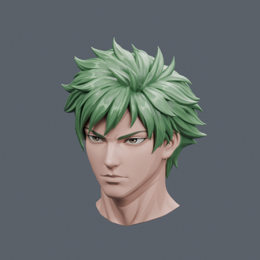 | **Teknium MMO Head** Modular MMO component Standalone modular component, not a full character. Head and glasses stay separate; no automatic assembly. | 528,904 vertices 1,057,860 triangles | 0 bones. Unrigged static mesh; no armature. | [.blend](https://github.com/123mikeyd/hermes-community-care-package/releases/download/characters-v0.1.0/teknium-mmo-head.blend) 105.4 MiB |
| 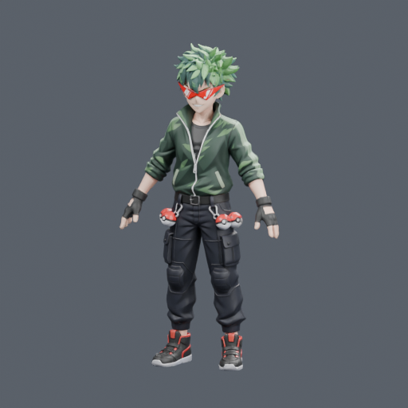 | **Teknium Pokemon Bound Rig** Pokemon Hero Same mesh/UV/packed image bytes as the older unbound Pokemon alternative, with an existing bound 24-bone rig. | 217,253 vertices 434,641 triangles | 24 bones. Bound native rig; sampled deformation responds; rough weights, not production animation acceptance. | [.blend](https://github.com/123mikeyd/hermes-community-care-package/releases/download/characters-v0.1.0/teknium-pokemon-bound-rig.blend) 68.8 MiB |
|  | **Teknium Pokemon Unbound Metarig** Pokemon Hero Same character skin as bound-rig alternative; older unbound metarig retained honestly. | 217,253 vertices 434,641 triangles | 159 bones. Existing unbound metarig; NOT a working deformation rig. | [.blend](https://github.com/123mikeyd/hermes-community-care-package/releases/download/characters-v0.1.0/teknium-pokemon-unbound-metarig.blend) 58.8 MiB |
| 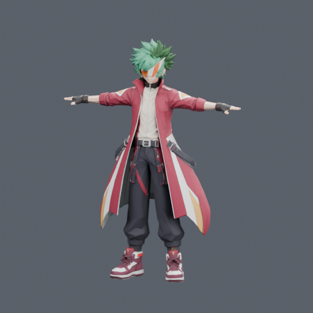 | **Teknium Burgundy Charcoal** Burgundy Charcoal Existing game palette reproduced, including game material constants; no new artist repaint. | 14,945 vertices 10,323 triangles | 24 bones. Bound native rig; sampled deformation responds; rough weights, not production animation acceptance. | [.blend](https://github.com/123mikeyd/hermes-community-care-package/releases/download/characters-v0.1.0/teknium-burgundy-charcoal.blend) 34.0 MiB |
| 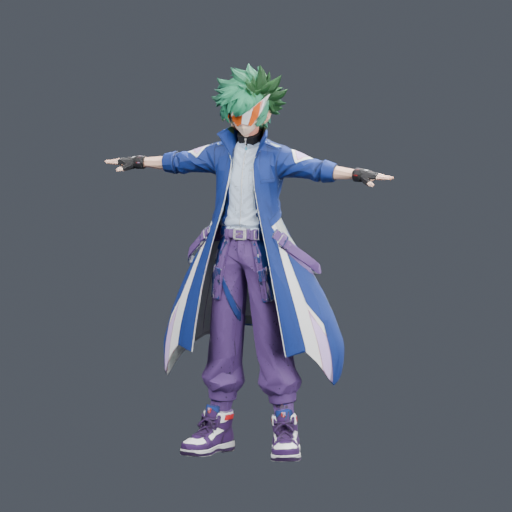 | **Teknium Midnight Violet** Midnight Violet Existing game palette reproduced, including game material constants; no new artist repaint. | 14,945 vertices 10,323 triangles | 24 bones. Bound native rig; sampled deformation responds; rough weights, not production animation acceptance. | [.blend](https://github.com/123mikeyd/hermes-community-care-package/releases/download/characters-v0.1.0/teknium-midnight-violet.blend) 34.3 MiB |
| 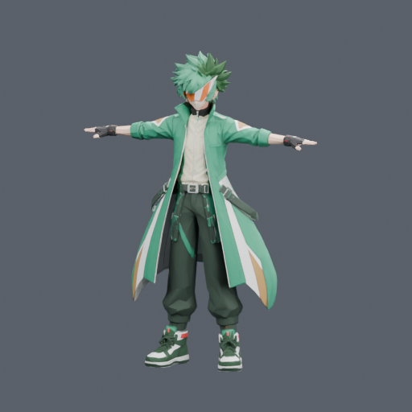 | **Teknium Emerald Forest** Emerald Forest Existing game palette reproduced, including game material constants; no new artist repaint. | 14,945 vertices 10,323 triangles | 24 bones. Bound native rig; sampled deformation responds; rough weights, not production animation acceptance. | [.blend](https://github.com/123mikeyd/hermes-community-care-package/releases/download/characters-v0.1.0/teknium-emerald-forest.blend) 34.2 MiB |
| 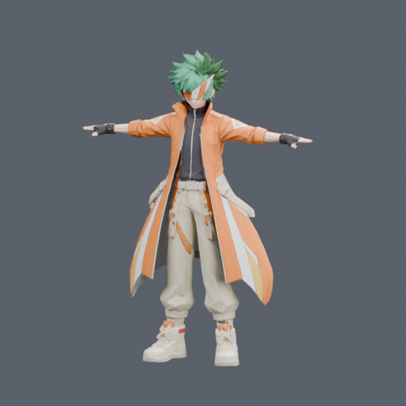 | **Teknium Tangerine Eggshell** Tangerine Eggshell Existing game palette reproduced, including game material constants; no new artist repaint. | 14,945 vertices 10,323 triangles | 24 bones. Bound native rig; sampled deformation responds; rough weights, not production animation acceptance. | [.blend](https://github.com/123mikeyd/hermes-community-care-package/releases/download/characters-v0.1.0/teknium-tangerine-eggshell.blend) 34.3 MiB |
|  | **Arts Bro** Native masked model Masked full-body model with the existing bound 66-bone rig. Three packed 4096 x 4096 texture maps. Separate unrigged duplicate omitted; no inherited Running Action. | 18,997 vertices 10,642 triangles | 66 bones. Bound native rig; sampled deformation responds; rough weights, not production animation acceptance. | [.blend](https://github.com/123mikeyd/hermes-community-care-package/releases/download/characters-v0.1.1/arts-bro.blend) 34.2 MiB |

## Verification scope

Every file was freshly reopened in background Blender 5.2. Geometry/topology/UV/material assignments, packed image bytes, vertex weights, rest bones, parents and native modifiers/constraints/drivers were compared against source data. Game palette files intentionally reproduce the existing game texture/material settings on the imported native mesh; they are not newly painted designs. Bound files passed small centered-skin deformation probes, not a full control-rig or animation/gameplay acceptance test. All contact sheets were visually checked. No artist source geometry was repaired or optimized.

## Skin inventory and duplicate handling

Classic Chess Coat, Green Jacket (descriptive label), Cyber Boxer, Tactical, Green Boxer, Pokemon Hero, Burgundy Charcoal, Midnight Violet, Emerald Forest, and Tangerine Eggshell are the discovered full-body families. Rigged/unrigged and high/low-density alternatives remain separate downloads but not extra skins. Tactical and Cyber Boxer metarigs are unbound; the older Pokemon metarig is likewise unbound, while its separate bound-rig alternative deforms. MMO Head, Glasses and Anime Shades are components, not three finished characters. The former generic game-character entry is represented only once as tdamre.

Discovery covered the parade/Fans/crew catalogs, the studio navigation index, the older Toy Box catalog, the active Legends costume configuration and all four referenced palettes, the Tek skin studies, Tek Boxer sources, Shadow Dock Pokemon integration, and modular MMO source. Animation-only revisions and vehicle/prop files were not counted as skins. This is the discovered, source-backed set—not a claim that no other artwork exists elsewhere.

---

[🏠 Home](../README.md) · **Characters** · [Toy Box](../toy-box/README.md) · [Playable Starter](../starter/README.md)
