[🏠 Home](../README.md) · [Characters](../characters/README.md) · **Toy Box** · [Playable Starter](../starter/README.md)

---

# Community Toy Box — pick one asset

**[Jump to models and downloads ↓](#browse-the-assets)**

**16 individual Blender assets · 14 GLB exports · textured previews**

Start with one toy rather than downloading a whole collection. [Beginner guide](GETTING_STARTED.md) · [Release downloads](https://github.com/123mikeyd/hermes-community-care-package/releases/tag/toy-box-v0.2.0) · [Original Pokémon collection](https://github.com/123mikeyd/hermes-community-care-package/releases/tag/toy-box-v0.1.0)

## Know what you are downloading

- These are dense editable source meshes, not an optimized game-ready pack. Triangle counts are listed per asset.
- Static props have no collision, interaction, or animation supplied. Characters are unrigged except for Pokémon Teknium's existing **unbound** metarig; it is not a working deformation-rig claim.
- All individual Blender files have packed textures and were freshly reopened. Fourteen GLBs passed Blender reimport geometry/material checks; no particular engine or mod compatibility is promised.
- Jessie and Pokémon Teknium are Blender-only: their GLBs failed round-trip checks and are not included.
- The head and each glasses variant are separate downloads. No source geometry was simplified or repaired for this release.
- Recognizable Pokémon/Team Rocket fan art and Teknium designs are identified by name, not presented as generic rights-cleared art. No blanket commercial-use license is asserted. See [notice](../NOTICE.md).

## Browse the assets

### Industrial Blast Door

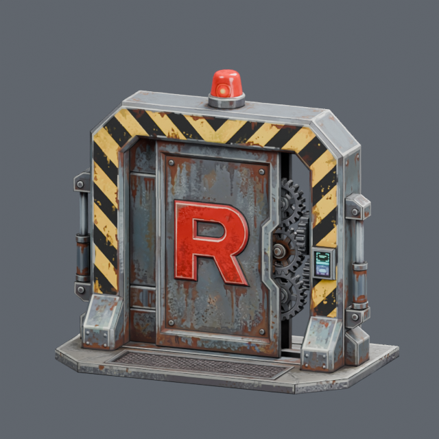

**Static mesh; no collision or interaction**

426,855 vertices · 855,172 triangles

[Download Blender — 62.3 MiB](https://github.com/123mikeyd/hermes-community-care-package/releases/download/toy-box-v0.2.0/industrial-blast-door.blend) · [Download GLB — 74.1 MiB](https://github.com/123mikeyd/hermes-community-care-package/releases/download/toy-box-v0.2.0/industrial-blast-door.glb)

### Militarized Zero-One Cart

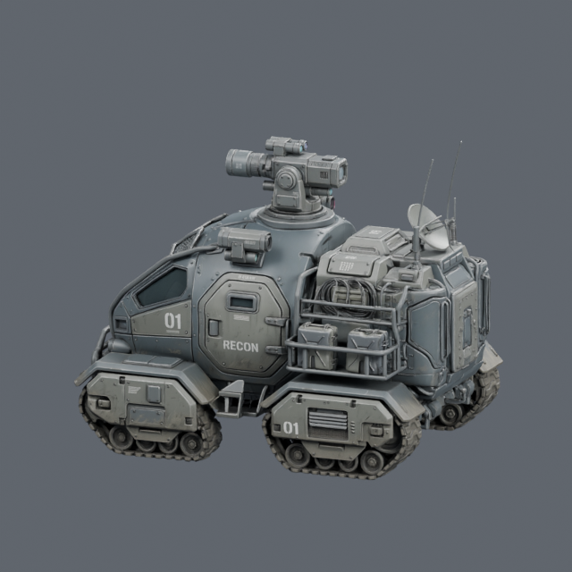

**Static mesh; no collision or interaction**

2,752,747 vertices · 5,511,377 triangles

[Download Blender — 282.9 MiB](https://github.com/123mikeyd/hermes-community-care-package/releases/download/toy-box-v0.2.0/militarized-zero-one-cart.blend) · [Download GLB — 204.8 MiB](https://github.com/123mikeyd/hermes-community-care-package/releases/download/toy-box-v0.2.0/militarized-zero-one-cart.glb)

### Poké Ball Flytrap Contraption

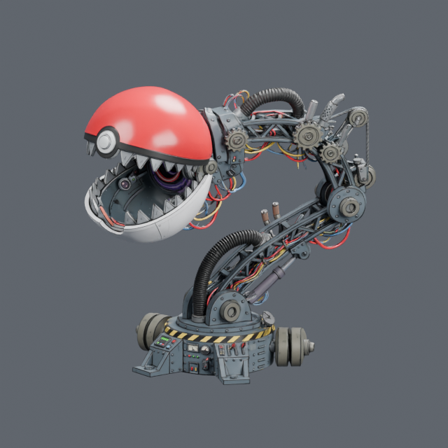

**Static mesh; no collision or interaction**

1,487,681 vertices · 2,977,070 triangles

[Download Blender — 163.8 MiB](https://github.com/123mikeyd/hermes-community-care-package/releases/download/toy-box-v0.2.0/poke-ball-flytrap-contraption.blend) · [Download GLB — 134.8 MiB](https://github.com/123mikeyd/hermes-community-care-package/releases/download/toy-box-v0.2.0/poke-ball-flytrap-contraption.glb)

### Team Rocket Raised Container

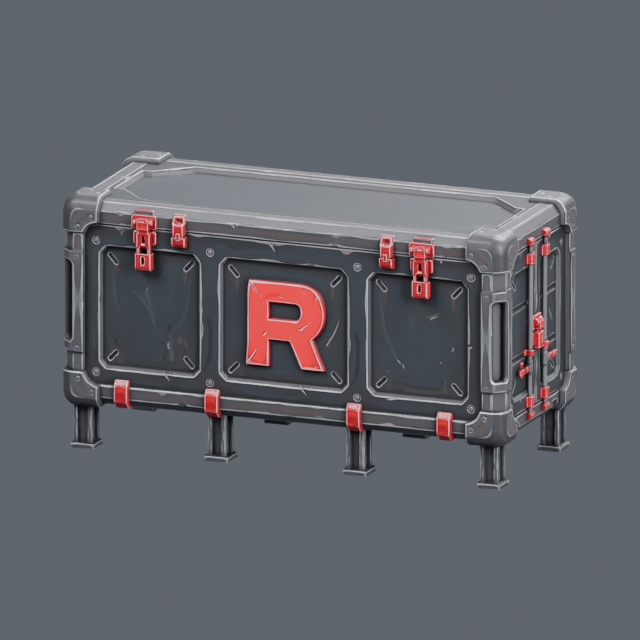

**Static mesh; no collision or interaction**

434,693 vertices · 882,634 triangles

[Download Blender — 61.1 MiB](https://github.com/123mikeyd/hermes-community-care-package/releases/download/toy-box-v0.2.0/team-rocket-raised-container.blend) · [Download GLB — 70.9 MiB](https://github.com/123mikeyd/hermes-community-care-package/releases/download/toy-box-v0.2.0/team-rocket-raised-container.glb)

### Team Rocket Watchtower and Helipad

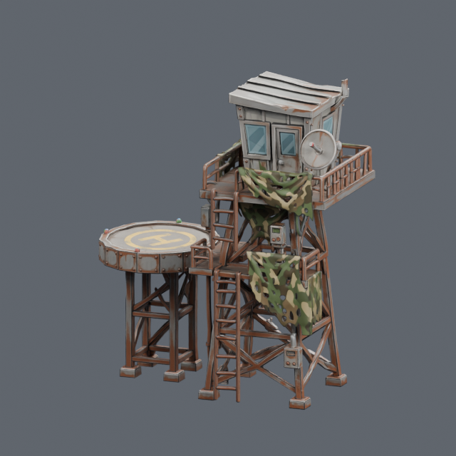

**Static mesh; no collision or interaction**

704,815 vertices · 1,410,409 triangles

[Download Blender — 91.9 MiB](https://github.com/123mikeyd/hermes-community-care-package/releases/download/toy-box-v0.2.0/team-rocket-watchtower-and-helipad.blend) · [Download GLB — 94.7 MiB](https://github.com/123mikeyd/hermes-community-care-package/releases/download/toy-box-v0.2.0/team-rocket-watchtower-and-helipad.glb)

### Smuggler Speedboat

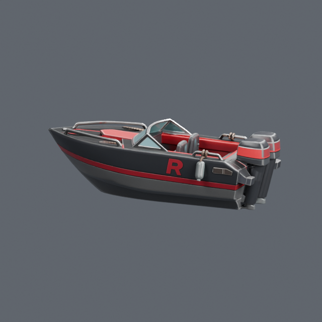

**Static mesh; no collision or interaction**

253,902 vertices · 507,884 triangles

[Download Blender — 39.8 MiB](https://github.com/123mikeyd/hermes-community-care-package/releases/download/toy-box-v0.2.0/smuggler-speedboat.blend) · [Download GLB — 54.1 MiB](https://github.com/123mikeyd/hermes-community-care-package/releases/download/toy-box-v0.2.0/smuggler-speedboat.glb)

### Squirtle Grotto Cave

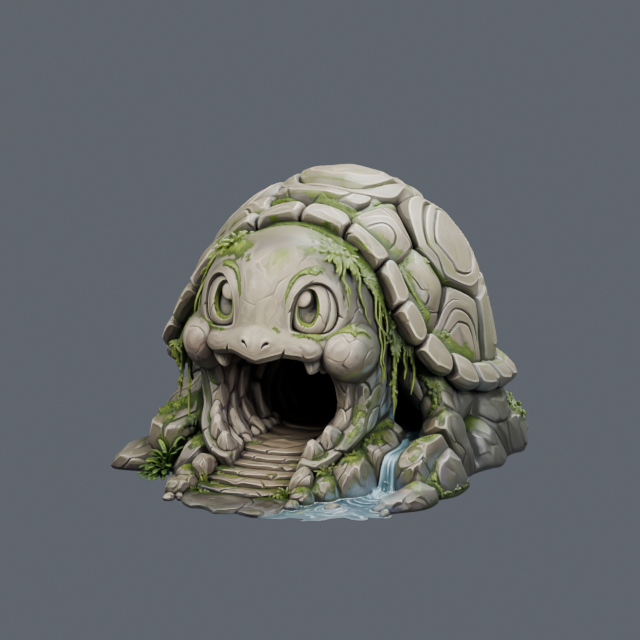

**Static mesh; no collision or interaction**

874,496 vertices · 1,749,350 triangles

[Download Blender — 100.6 MiB](https://github.com/123mikeyd/hermes-community-care-package/releases/download/toy-box-v0.2.0/squirtle-grotto-cave.blend) · [Download GLB — 94.9 MiB](https://github.com/123mikeyd/hermes-community-care-package/releases/download/toy-box-v0.2.0/squirtle-grotto-cave.glb)

### Supply Crates and Drums

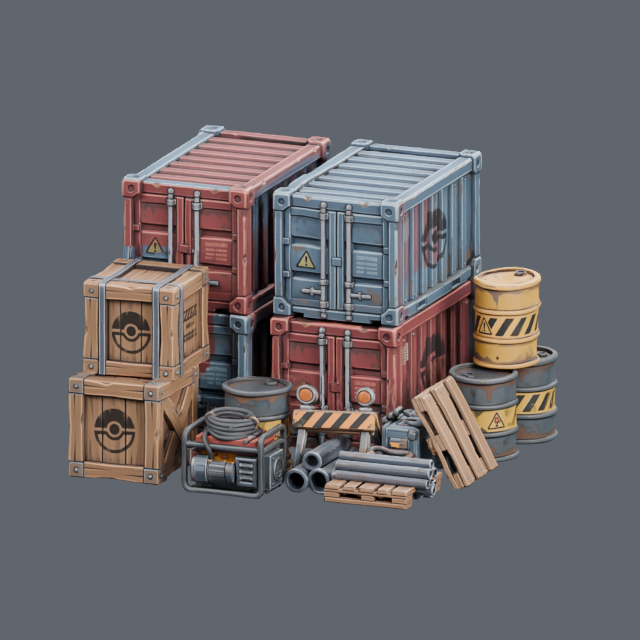

**Static mesh; no collision or interaction**

1,653,182 vertices · 3,308,604 triangles

[Download Blender — 183.3 MiB](https://github.com/123mikeyd/hermes-community-care-package/releases/download/toy-box-v0.2.0/supply-crates-and-drums.blend) · [Download GLB — 147.9 MiB](https://github.com/123mikeyd/hermes-community-care-package/releases/download/toy-box-v0.2.0/supply-crates-and-drums.glb)

### Team Rocket Helicopter

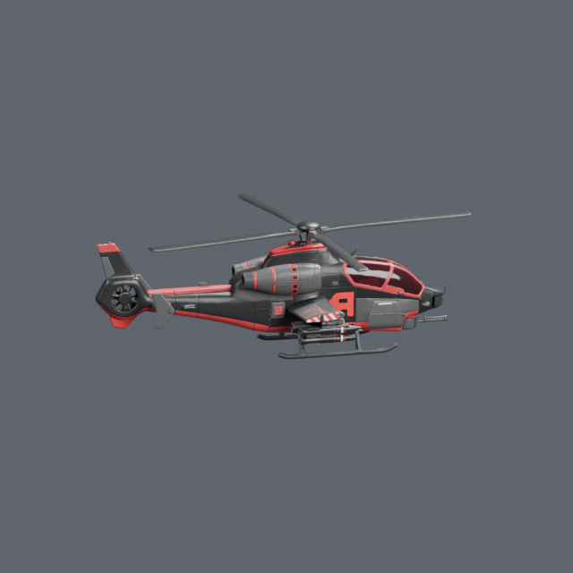

**Static mesh; no collision or interaction**

234,489 vertices · 469,109 triangles

[Download Blender — 39.2 MiB](https://github.com/123mikeyd/hermes-community-care-package/releases/download/toy-box-v0.2.0/team-rocket-helicopter.blend) · [Download GLB — 54.8 MiB](https://github.com/123mikeyd/hermes-community-care-package/releases/download/toy-box-v0.2.0/team-rocket-helicopter.glb)

### James

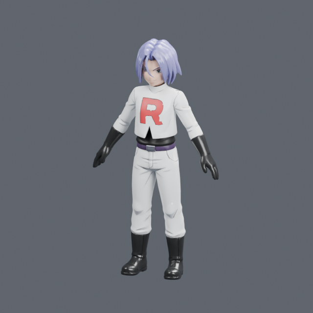

**Unrigged character or component**

22,544 vertices · 45,086 triangles

[Download Blender — 18.6 MiB](https://github.com/123mikeyd/hermes-community-care-package/releases/download/toy-box-v0.2.0/james.blend) · [Download GLB — 39.0 MiB](https://github.com/123mikeyd/hermes-community-care-package/releases/download/toy-box-v0.2.0/james.glb)

### Jessie

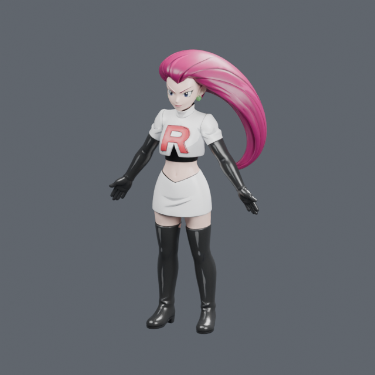

**Unrigged character or component**

44,321 vertices · 88,682 triangles

[Download Blender — 20.5 MiB](https://github.com/123mikeyd/hermes-community-care-package/releases/download/toy-box-v0.2.0/jessie.blend) · **GLB omitted: failed round-trip check.**

### Pokémon Teknium with Existing Metarig

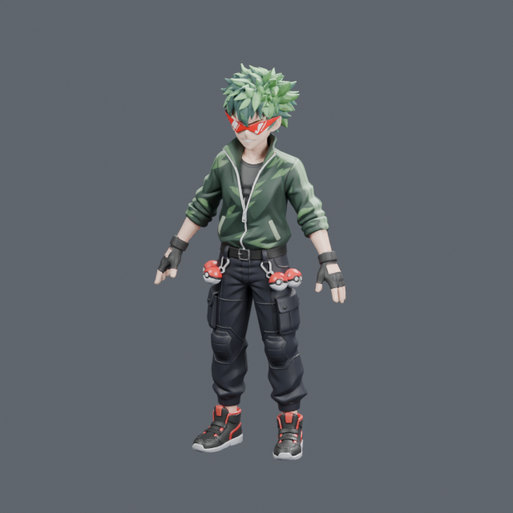

**Existing unbound metarig; deformation not established**

217,253 vertices · 434,641 triangles · 159 existing bones

[Download Blender — 40.2 MiB](https://github.com/123mikeyd/hermes-community-care-package/releases/download/toy-box-v0.2.0/pokemon-teknium-with-existing-metarig.blend) · **GLB omitted: failed round-trip check.**

### Wooden Docking Pier

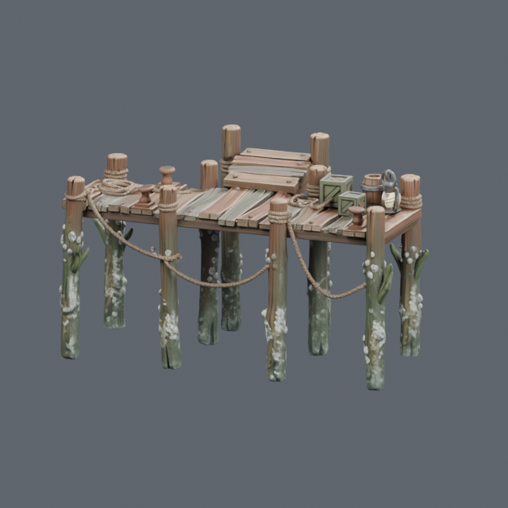

**Static mesh; no collision or interaction**

531,148 vertices · 1,062,574 triangles

[Download Blender — 69.3 MiB](https://github.com/123mikeyd/hermes-community-care-package/releases/download/toy-box-v0.2.0/wooden-docking-pier.blend) · [Download GLB — 77.4 MiB](https://github.com/123mikeyd/hermes-community-care-package/releases/download/toy-box-v0.2.0/wooden-docking-pier.glb)

### MMO Teknium Anime Shades

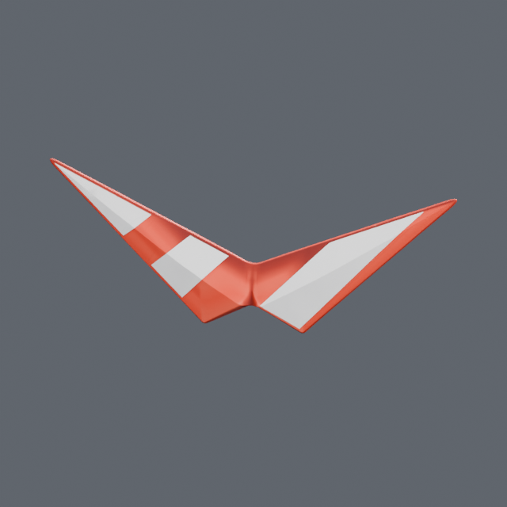

**Unrigged character or component**

27,146 vertices · 54,288 triangles

[Download Blender — 20.8 MiB](https://github.com/123mikeyd/hermes-community-care-package/releases/download/toy-box-v0.2.0/mmo-teknium-anime-shades.blend) · [Download GLB — 43.5 MiB](https://github.com/123mikeyd/hermes-community-care-package/releases/download/toy-box-v0.2.0/mmo-teknium-anime-shades.glb)

### MMO Teknium Glasses

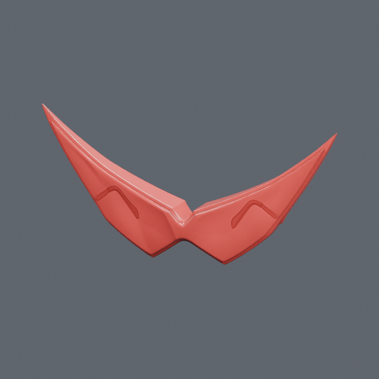

**Unrigged character or component**

94,114 vertices · 188,224 triangles

[Download Blender — 22.8 MiB](https://github.com/123mikeyd/hermes-community-care-package/releases/download/toy-box-v0.2.0/mmo-teknium-glasses.blend) · [Download GLB — 42.3 MiB](https://github.com/123mikeyd/hermes-community-care-package/releases/download/toy-box-v0.2.0/mmo-teknium-glasses.glb)

### MMO Teknium Head

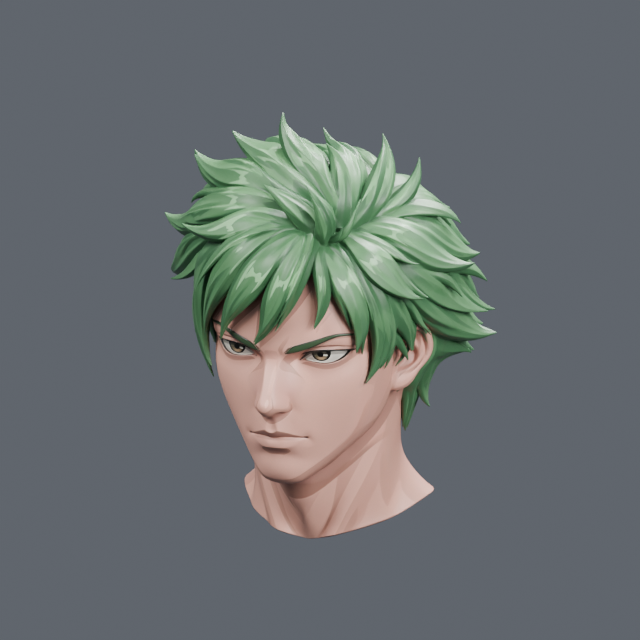

**Unrigged character or component**

528,904 vertices · 1,057,860 triangles

[Download Blender — 62.2 MiB](https://github.com/123mikeyd/hermes-community-care-package/releases/download/toy-box-v0.2.0/mmo-teknium-head.blend) · [Download GLB — 64.0 MiB](https://github.com/123mikeyd/hermes-community-care-package/releases/download/toy-box-v0.2.0/mmo-teknium-head.glb)

## Verification scope

Checks cover source mesh/UV/material/transform preservation, packed image bytes and dimensions, fresh Blender reopening, and GLB reimport checks where offered. All thumbnails were visually reviewed. These checks do not establish optimized performance, working rig deformation, collision, animation, or game compatibility.

The original Pokémon collection and the Misty Mountain playable starter remain unchanged. The older combined MMO collection has been withdrawn; the separate head and glasses downloads remain available. This release adds browsing and individual downloads; it does not add a new playable scene.

---

[🏠 Home](../README.md) · [Characters](../characters/README.md) · **Toy Box** · [Playable Starter](../starter/README.md)
